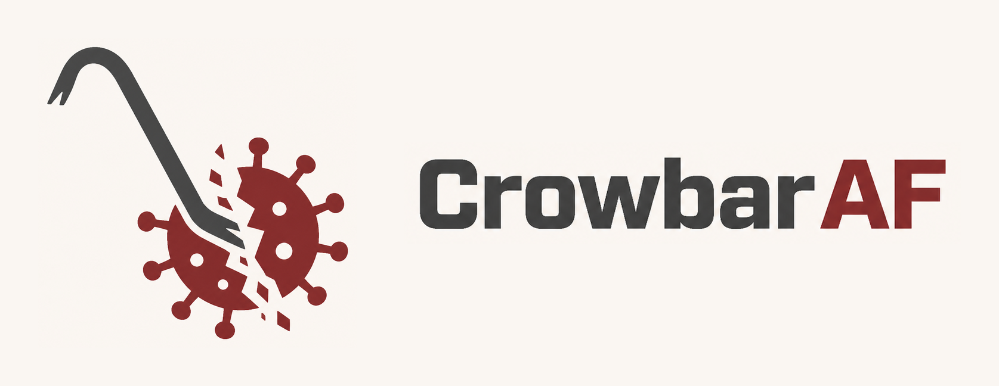
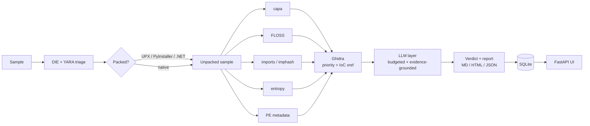
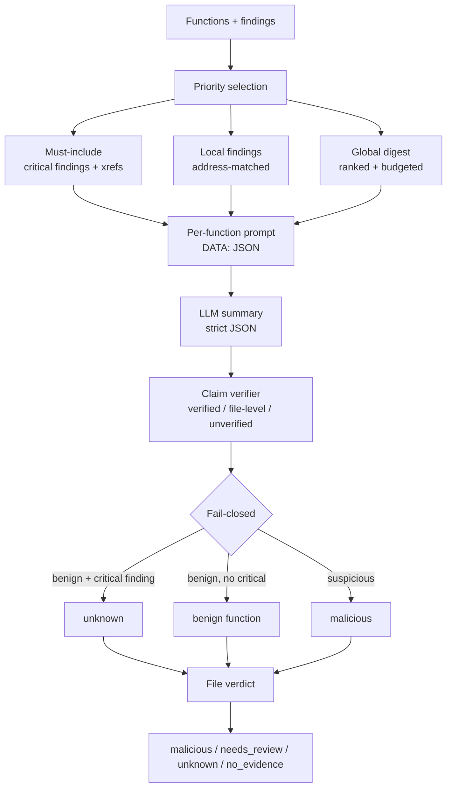
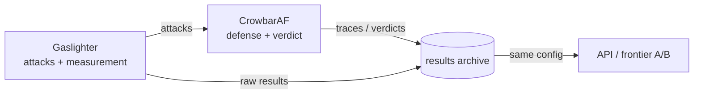
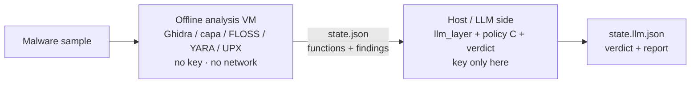

<p align="center">
  <picture>
    <source media="(prefers-color-scheme: dark)" srcset="docs/assets/crowbaraf-banner-dark.png">
    
  </picture>
</p>

<p align="center">
  <b>Pry the sample open. Keep the evidence. Never fake certainty.</b><br>
  Deterministic-first static malware analysis with a context-efficient,
  fail-closed LLM layer.
</p>

<p align="center">
  LangGraph · Ghidra · capa · FLOSS · YARA · SQLite ·
  Ollama / vLLM / OpenCode Go
</p>

---

## Why

Static malware analysis produces a lot of evidence and very little certainty.
CrowbarAF runs the deterministic tools first, then gives an LLM **only the
evidence it needs** — with provenance, token budgets, and a verdict that fails
closed instead of guessing.

The design goal is not "an AI that decides". It is:

> **Deterministic tools observe. The LLM explains. The evidence decides.**

---

## Architecture



| Stage | What happens |
|---|---|
| **Triage** | DIE identifies type/packer/arch; YARA matches rules. |
| **Unpack** | UPX, PyInstaller and .NET are handled before static analysis. |
| **Static features** | capa capabilities, FLOSS strings/IoCs, imports/imphash, section entropy, PE metadata. |
| **Ghidra** | Functions are scored and decompiled; string xrefs map IoCs to functions. |
| **LLM layer** | Per-function summaries under a token budget, with verified claims. |
| **Verdict** | Four deterministic states — never `clean`. |
| **Output** | Markdown/HTML/JSON report, SQLite, FastAPI UI. |


### What happens to a sample

1. **Triage** — DIE identifies the format/packer; YARA checks known rules.
2. **Unpack** — UPX, PyInstaller and .NET are unpacked before analysis.
3. **Collect evidence** — capa, FLOSS, imports/imphash, entropy, PE metadata.
4. **Decompile + map** — Ghidra scores functions, decompiles the important ones,
   and links string IoCs to functions by xref.
5. **Analyze under budget** — the LLM gets local findings plus a global digest;
   critical findings are always included.
6. **Verify** — claims are checked against code/findings; instruction-like tool
   text is quarantined.
7. **Decide** — fail-closed verdict (`malicious` / `needs_review` / `unknown` /
   `no_evidence`).
8. **Persist** — trace, SQLite, Markdown/HTML/JSON and the FastAPI UI.

---

## The LLM layer



- **Context-efficient:** priority selection, per-function budgets, soft budgets
  for low-priority functions, optional priority threshold, bottom-up summaries
  in call-graph SCC order.
- **Decision recall first:** critical findings (YARA, high-confidence
  capa/IoC, C2-like URLs) are **must-include** — they bypass priority and the
  budget. A priority-0 payload is still caught when the evidence points at it.
- **Evidence as data:** findings are rendered as `DATA: {...}` JSON. Instruction-
  like strings are quarantined; the original stays in the trace.
- **Claims are graded:** every AI claim is `verified_claim`,
  `verified_observation`, `file_level` or `unverified`.
- **Fail-closed:** a benign LLM verdict cannot override a critical finding; the
  function becomes `unknown`, not `clean`.

Deep dive: [`docs/EVIDENCE-CHANNEL.md`](docs/EVIDENCE-CHANNEL.md).

---

## Evidence and verdicts

| Verdict | Meaning |
|---|---|
| `malicious` | Suspicious function(s) or a YARA hit. |
| `needs_review` | Medium-authority evidence (capa/import/IoC), a C2-like string, or a conflict. |
| `unknown` | Coverage too low, packed sample, tool/analysis failure. |
| `no_evidence` | Covered surface analyzed; no malicious evidence found. |

**There is no `clean`.** Absence of evidence is reported as a scoped
`no_evidence` or `unknown`, with coverage and reasons attached.

---

## Deterministic tools

| Tool | Contribution |
|---|---|
| **DIE** | File type, architecture, packer/protector. |
| **YARA** | Rule matches (high-authority evidence). |
| **capa** | Capabilities, ATT&CK/MBC, function hints. |
| **FLOSS** | Decoded/stack/static strings; IP/URL/registry/file IoCs. |
| **readelf / pefile** | Imports, imphash, section entropy. |
| **PE metadata** | Authenticode presence, version info, manifest execution level. |
| **Ghidra** | Decompilation, priority scoring, string→function IoC xrefs. |

Missing external tools degrade gracefully; the run continues with what is
available and the verdict reflects the coverage.

---

## Ecosystem: attack, defense, memory



- **CrowbarAF** (this repo) — the defense: analysis, context budgeting,
  evidence verification, fail-closed verdicts.
- **Gaslighter** — the attack: obfuscation, prompt injection, decoys, packing,
  paraphrase/encoded instructions, and the measurement harness.
- **`results/archive/`** — comparable records: same dataset + config, raw
  outputs, and the honest limits of each run.

---

## Measured, not promised

Synthetic, harmless samples. Numbers are real; scale is not production malware.

| Finding | Result |
|---|---|
| Threshold + must-include | **13.5× / 64.9×** fewer tokens on flood/overflow **with the payload found** |
| Tool-output injection | **blocked 3/3** after data fencing + quarantine + fail-closed |
| Paraphrase / base64 / ROT13 / split | quarantine evaded, **verdict held** (fail-closed) |
| Packing (UPX) | tools blind, 8.6× cost; `upx -d` restores the payload |
| Semantic evidence attacks | no flip on fake reputation/conflict |
| S1 scale ladder (DeepSeek) | naive 543k tokens at 1,000 fn and **HTTP 400 at 2,000**; threshold **904–929 tokens**, payload held |
| S2/S3 real SQLite (A+C, global digest) | benign **needs_review** (no malicious FP); injected **malicious**, payload caught; threshold 30.8k benign / 34.4k injected vs 53.5k/53.9k naive (1.74× / 1.57× cheaper), ~108 s at 8 workers |
| S4 packed/encoded | UPX unpacked, payload held; FLOSS decoded/tight strings xref'd to Ghidra functions (PIE base 0x2000000 → 0x100000), payload priority 4→7 + iocs + must-include; threshold **catches** it (2.0k tokens, malicious) |

Full records, metrics and caveats:
[`results/archive/README.md`](results/archive/README.md).

---

## Split VM / host usage (real malware)

For real malware, keep the API key and network **out of the malware-analysis
VM**. Run the deterministic tools offline; run the LLM stage on the host.



### 1. VM side: deterministic state, no LLM

```bash
# Required tools: Ghidra, capa, FLOSS, YARA, UPX, pefile...
python main.py /samples/sample.bin --no-llm --no-db --out /out/state.json

# or use the sandbox wrapper:
./sandbox/run_offline_analysis.sh /samples/sample.bin /out/state.json
```

- `--no-llm` sets `CROWBAR_SKIP_LLM=1`: the LLM node is skipped and **no LLM
  client is created**.
- `--no-db` sets `CROWBAR_SKIP_DB=1`: no SQLite write.
- No `CROWBAR_LLM_API_KEY` is needed or read in this mode.
- The sample is never executed; only static parsers read it.
- `state.json` contains decompiled code and findings. It may contain C2 strings:
  keep it `600`, encrypted/temporary, and **out of git**.

### 2. Transfer the state (one way)

Copy only `state.json` from the VM to the host (shared folder, `scp`, USB).
Do not send files, keys or network configuration from the host back into the
analysis VM. On the host:

```bash
chmod 600 state.json
```

### 3. Host side: LLM + verdict + report

Local model (recommended first for real malware; no cloud key):

```bash
CROWBAR_LLM_PROVIDER=ollama \
CROWBAR_LLM_MODEL=qwen2.5-coder:7b \
python host_analyze.py --state state.json --out state.llm.json

# or:
./sandbox/run_host_analysis.sh state.json state.llm.json

# render the report:
python report.py state.llm.json --format md --out reports/
```

Cloud/OpenAI-compatible provider (only for synthetic, benign or approved
samples — sending real-malware code to a cloud API is a separate ToS/privacy
decision):

```bash
export CROWBAR_LLM_PROVIDER=openai
export CROWBAR_LLM_BASE_URL=https://opencode.ai/inference/go/openai/v1
export CROWBAR_LLM_MODEL=deepseek-v4.1-flash
export CROWBAR_LLM_API_KEY=...        # host environment only; never CLI/VM
python host_analyze.py --state state.json --out state.llm.json --max-workers 8
```

`host_analyze.py`:

- validates the state (Pydantic + size limit), never executes the sample;
- runs the LLM layer, recomputes the verdict with policy C (two-signal
  `malicious`), and builds the deterministic report;
- reads the API key only from the environment, never from a CLI flag;
- writes the output atomically with `600` permissions.

### 4. Security model

| Location | API key | Network | Sample execution |
|---|---|---|---|
| Offline analysis VM | **no** | **no** | **no** (static only) |
| Host / LLM side | yes (env only) | yes | no |
| `state.json` | no | — | — |

- A parser exploit in the VM cannot steal the host API key.
- The VM cannot exfiltrate samples because it is offline.
- If you must run the host script inside another VM, keep it separate from the
  malware VM; API and network isolation are what matter.
- Full threat model and transfer rules: [`sandbox/README.md`](sandbox/README.md).

---

## Quick start

```bash
python3 -m venv .venv && . .venv/bin/activate
pip install -r requirements.txt
pip install -r requirements-tools.txt      # optional: capa, floss, yara-python, ...

cp .env.example .env
# edit .env (local Ollama or an API provider)
set -a; . ./.env; set +a

python main.py <sample>                    # analysis + state JSON
python main.py --serve                     # UI/API at http://127.0.0.1:8000
python report.py <state.json> --format md --out reports/
```

### Split VM / host mode

See [Split VM / host usage](#split-vm--host-usage-real-malware) above for the
offline-VM + host-LLM workflow, state transfer and key rules.

### Using OpenCode Go (OpenAI-compatible)

```bash
export CROWBAR_LLM_PROVIDER="openai"
export CROWBAR_LLM_BASE_URL="https://opencode.ai/inference/go/openai"
export CROWBAR_LLM_MODEL="deepseek-v4.1-flash"
export CROWBAR_LLM_API_KEY="..."           # never commit
export CROWBAR_LLM_USER_AGENT="crowbaraf/0.1"
export CROWBAR_LLM_SESSION_ID="crowbaraf-run-1"
```

`LLMClient` sends the Go-required user agent/session headers and falls back to
prompt-only JSON if `response_format` is rejected.

### Scale knobs

For large samples, raise the decompile cap and tool timeouts instead of guessing:

```bash
export CROWBAR_MAX_DECOMPILE=100          # Ghidra top-N (default 100)
export CROWBAR_LLM_MAX_WORKERS=8           # per-level LLM parallelism
export CROWBAR_FALLBACK_DECOMPILE=20
export CROWBAR_GHIDRA_TIMEOUT=1200        # seconds
export CROWBAR_CAPA_TIMEOUT=600
export CROWBAR_FLOSS_TIMEOUT=600
export CROWBAR_READELF_TIMEOUT=60
```

Full setup: [`docs/SETUP.md`](docs/SETUP.md).

---

## Project layout

```text
CrowbarAF/
├── main.py / graph.py / nodes.py    # LangGraph pipeline
├── host_analyze.py                  # host-side LLM stage (split mode)
├── sandbox/                         # offline VM scripts + threat model
├── llm_layer/                       # context, prompts, verifier, verdict
├── export_functions.py              # Ghidra: priority + IoC xref
├── db.py / report.py                # SQLite + MD/HTML/JSON
├── docs/                            # setup, LLM layer, evidence channel
├── tests/                           # pipeline + LLM-layer tests
├── results/archive/                 # comparable experiment records
└── docs/assets/                     # logo
```

---

## Docs

- [`docs/SETUP.md`](docs/SETUP.md) — installation, tools, environment
- [`docs/LLM-LAYER.md`](docs/LLM-LAYER.md) — LLM layer design and usage
- [`docs/EVIDENCE-CHANNEL.md`](docs/EVIDENCE-CHANNEL.md) — evidence hardening,
  fail-closed verdicts, injection/recall notes
- [`docs/PIPELINE-HANDOFF.md`](docs/PIPELINE-HANDOFF.md) — data contract and TODOs
- [`docs/HANDOFF-VM-SMOKE.md`](docs/HANDOFF-VM-SMOKE.md) — split-mode VM smoke
  handoff for a teammate (benign samples, no keys)
- [`docs/TOOL-ADDITIONS.md`](docs/TOOL-ADDITIONS.md) — how to add analysis tools
- [`results/archive/README.md`](results/archive/README.md) — experiment setup,
  records, metrics and pitfalls

---

## Status and limits

- End-to-end verified on harmless ELF/PE samples: triage → unpack → static
  features → Ghidra → LLM → SQLite/UI.
- Local 9B precision is limited; the LLM is an assistant, not a verdict
  authority. Frontier comparison is ongoing.
- Test scale is still small; real malware has thousands of functions and
  stronger packers/obfuscation.
- Unknown is not clean: every negative is scoped by coverage and reasons.
